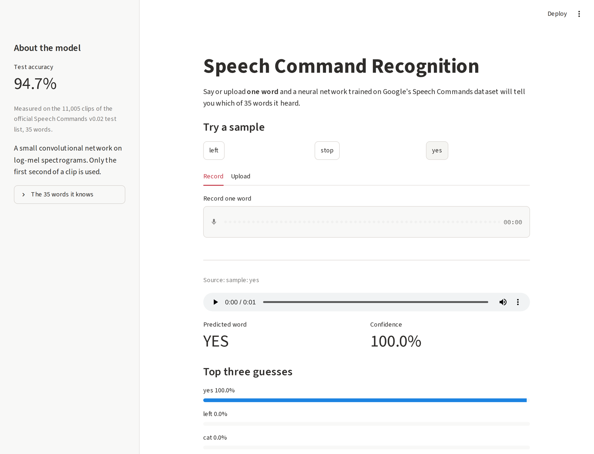
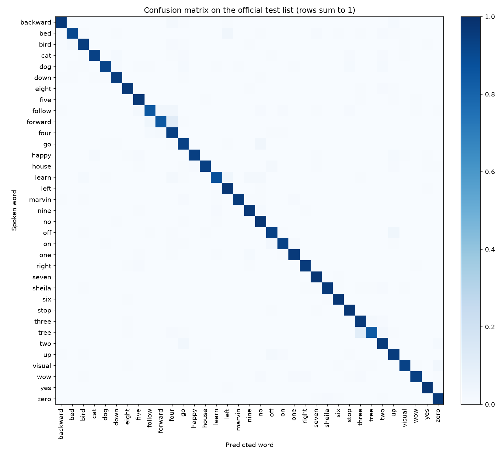

# Speech Command Recognition

A small convolutional network that recognises 35 spoken English words from one-second audio clips. It is trained on Google's Speech Commands v0.02 dataset and reaches **94.7% accuracy on the dataset's official test list**: 11,005 clips from speakers the model never heard during training.

**[Try the live demo](https://librosaiscool.streamlit.app)**: click a sample, record a word with your microphone, or upload a WAV file. The free host puts the app to sleep when it is idle; if you see a wake-up button, press it and give it a minute.

<p align="center">
  
</p>

## Results

| | |
|---|---|
| Test accuracy | **94.7%** |
| Macro F1 | 0.942 |
| Test clips | 11,005 (official `testing_list.txt`) |
| Classes | 35 words |
| Model size | 245,831 parameters, 1,031 KB on disk |

<p align="center">
  
</p>

The words the model mixes up most often:

- "tree" heard as "three": 21 clips
- "forward" heard as "four": 17 clips
- "off" heard as "up": 15 clips
- "go" heard as "no": 13 clips
- "two" heard as "go": 12 clips

Precision, recall and F1 for every word are in [results/per_class.md](results/per_class.md). Nothing in this section is typed by hand: `scripts/evaluate.py` writes `results/metrics.json`, the per-class table and the confusion matrix, and the numbers above are copied from that file.

## Quick start

Python 3.12.

```bash
git clone https://github.com/yxshee/speech-command-recognition.git
cd speech-command-recognition
python3 -m venv .venv && source .venv/bin/activate   # Windows: .venv\Scripts\activate
pip install -r requirements.txt
streamlit run app.py
```

Open http://localhost:8501 and click one of the sample buttons, or record a word. The trained model (`model/wavmodel.keras`) is in the repository, so nothing needs to be downloaded or trained to try it.

The 35 words: backward, bed, bird, cat, dog, down, eight, five, follow, forward, four, go, happy, house, learn, left, marvin, nine, no, off, on, one, right, seven, sheila, six, stop, three, tree, two, up, visual, wow, yes, zero.

## How it works

1. **Audio in.** Any clip is decoded to mono, resampled to 16 kHz, and cut or zero-padded to exactly one second (`speech_commands/audio.py`).
2. **Features.** A log-mel spectrogram: 25 ms windows every 10 ms, 40 mel bands between 20 Hz and 7.6 kHz, which gives a 98 × 40 array (`speech_commands/features.py`). Training, evaluation and the app all call this one function, so the network always sees audio prepared the same way.
3. **Model.** Four convolution blocks (32, 64, 128 and 128 filters, each with batch normalisation and ReLU), global average pooling, dropout, and a 35-way output layer (`scripts/train.py`).
4. **Answer.** A softmax over the 35 outputs. The app shows the best word, its probability and the next two guesses.

## Training

```bash
python scripts/train.py --download   # fetches Speech Commands v0.02, about 2.4 GB
python scripts/evaluate.py           # writes results/
```

- **Data split.** The dataset's own `validation_list.txt` and `testing_list.txt` decide what is held out: 84,843 training, 9,981 validation and 11,005 test clips. Those lists keep each speaker in one split only, so the test score measures new voices, not memorised ones.
- **Augmentation**, on training clips only: a random shift of up to 100 ms, and, four times out of five, a random second of the dataset's background-noise recordings mixed in.
- **Optimisation.** Adam, learning rate 0.001 halved when validation loss stalls, batch size 128, early stopping. The weights from the epoch with the best validation accuracy are the ones saved (epoch 28 of 30, 95.3% validation accuracy).

The committed model was trained on a Kaggle GPU. The training curves are in `results/training_history.json`.

## Limitations

- **It always answers with one of the 35 words.** There is no "silence" or "unknown word" class, so noise, silence and other words still get an answer. The app flags predictions below 50% confidence, which helps but is not a real rejection mechanism.
- **Only the first second is used.** A word that starts late or runs long is cut off.
- **The test set comes from the same collection as the training set**: short clips recorded by volunteers on their own devices. Accuracy on far-field microphones, heavy noise, children's voices or accents that are rare in the dataset has not been measured and is likely to be lower.
- **It was trained on human voices.** A synthesised "stop" tried during development was heard as "four".
- **English only.**

## Project layout

| Path | Contents |
|---|---|
| `app.py` | The Streamlit demo |
| `speech_commands/audio.py` | Decoding, resampling, padding to one second |
| `speech_commands/features.py` | The log-mel spectrogram |
| `speech_commands/labels.py` | The 35 words, in model-output order |
| `speech_commands/inference.py` | Loading the model, softmax, top-three prediction |
| `speech_commands/dataset.py` | Download and the official train / validation / test split |
| `scripts/train.py`, `scripts/evaluate.py` | Training and evaluation |
| `model/wavmodel.keras` | The trained model |
| `results/` | Metrics, per-class table, confusion matrix, training curves |
| `tests/` | Tests for audio handling, features, the split, inference and the app |
| `assets/samples/` | Three clips from the official test list, used by the demo's sample buttons and by the tests |

## Tests

```bash
pip install -r requirements-dev.txt
pytest -q
```

The tests cover audio decoding (sample rates, stereo, corrupt files), the feature function, the data split (on a synthetic directory, no download needed), the prediction code, the committed model's answers for the three sample clips, and the app itself through Streamlit's test harness. They run on every push in [GitHub Actions](.github/workflows/tests.yml).

## A note on earlier numbers

An earlier version of this README reported 85.65% test accuracy. That figure came from a notebook that split the files at random, so the same speakers appeared in training and test data, and whose model had six output classes that were not words. It could not be reproduced from the repository. The model was retrained from scratch with the pipeline described above, and the old notebook was removed; it remains in the git history.

## Dataset and licence

Speech Commands v0.02 is by Pete Warden (Google) and is released under the Creative Commons BY 4.0 licence: Warden, P. (2018). *Speech Commands: A Dataset for Limited-Vocabulary Speech Recognition*. arXiv:1804.03209. See [dataset/dataset.md](dataset/dataset.md).

This repository is licensed under CC BY 4.0. See [LICENSE](LICENSE).
